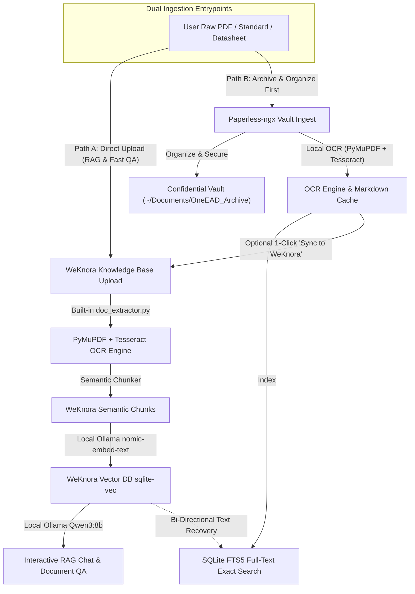

# Paperless-ngx (Lite Mode) — One EAD Plugin

**Paperless-ngx** for One EAD is a local-first, privacy-focused document vault, offline OCR pipeline, and document management platform. It organizes technical specifications, acoustics research papers, component datasheets, and design guidelines with zero cloud dependencies and 100% offline data privacy.

---

## 1. Core Architecture & Privacy by Design

### External Vault Isolation (`~/Documents/OneEAD_Archive`)
All confidential documents, PDFs, OCR texts, and SQLite databases are stored **strictly outside the Git workspace**:
* **Default Vault Path**: `C:\Users\<USER>\Documents\OneEAD_Archive`
* **Custom Override**: Configurable via the `ONEEAD_ARCHIVE_DIR` environment variable.

```
~/Documents/OneEAD_Archive/
├── documents/                  # Physical PDFs organized by category subfolders
│   ├── General Acoustic Knowledge/
│   ├── Component Datasheet/
│   ├── Acoustic Standard/
│   └── Design Guideline/
├── meta.db                     # SQLite database (documents table & FTS5 virtual table)
├── ocr_cache/                  # Extracted full-text Markdown files ({doc_id}.md)
├── thumbnails/                 # First-page PNG rendering cache
└── weknora_data/               # WeKnora Lite persistent database & vector storage
```

> [!IMPORTANT]
> **Data Privacy Guarantee**: Because files reside in `~/Documents/OneEAD_Archive`, user PDFs and confidential documents can never be accidentally committed to git, inspected by automated git hooks, or ingested by version control tooling.

---

## 2. Key Features & Implementation Details

### A. Instant Unified Toolbar & Full-Text Search (FTS5)
- **Dual Search Scopes**:
  - `Title + OCR` (Default): Searches both document filenames and extracted deep OCR/vector text in milliseconds using SQLite's native `fts5` virtual table with the `unicode61` tokenizer.
  - `Title Only`: Instant client-side filter by filename.
- **Debounced Execution**: Full-text queries debounce at 280ms to provide a lag-free search experience as you type.
- **Dynamic Category & Status Filtering**: Real-time filtering by category folders (e.g., *Component Datasheet*, *Acoustic Standard*) and OCR completion statuses (*OCR Ready*, *Digital*, *Pending*).

### B. Saved Views & Navigation
- **Documents**: Master list of all vault documents with active category breadcrumbs.
- **Recently Added**: Chronologically sorted view (newest ingested files first via `created_at` timestamp comparison).
- **Category Folders**: Instant filtered view with file counts.
- **Dashboard**: High-level telemetry displaying total files, disk vault size, and OCR engine status.

### C. 1-Click Windows File Explorer Integration
- Clicking **Explorer** on any document card or category opens the exact folder in Windows File Explorer.
- Uses Windows Win32 Shell APIs (`SHOpenFolderAndSelectItems`, `AttachThreadInput`, `BringWindowToTop`, `SetForegroundWindow`) to bring the matching Explorer window to the foreground and automatically highlight the exact file.

### D. Offline Hybrid OCR Engine (Tesseract + PyMuPDF)
- **Vector Extraction**: Native digital text and tables in PDFs are extracted instantaneously via PyMuPDF (`fitz`).
- **Scanned Image Detection**: Pages with raster images or scanned text automatically fall back to local Tesseract OCR (autodetected at `C:\Program Files\Tesseract-OCR\tesseract.exe` or custom `TESSERACT_CMD`).
- **Smooth Large-Document Previews**: Document Markdown previews are delivered with a lightweight `?limit=40000` character preview and a "Load Complete Full Text" option, preventing browser freezes when previewing multi-megabyte technical manuals.
- **In-Memory Thumbnail Caching**: Thumbnails are served with `Cache-Control: public, max-age=86400, immutable`, preventing redundant disk reads.

---

## 3. Relationship with WeKnora Plugin

Paperless-ngx and [WeKnora](../weknora/README.md) work together as a complementary pair inside One EAD:

| Capability | Paperless-ngx | WeKnora (Lite Mode) |
| :--- | :--- | :--- |
| **Primary Role** | **Vault Storage, Organization & OCR** | **LLM Knowledge Retrieval (RAG) & Chat** |
| **Search Engine** | Exact keyword full-text search (SQLite `FTS5`) | Semantic vector similarity (`sqlite-vec`) + Hybrid |
| **Data Format** | Original PDFs, thumbnails, and Markdown cache | Chunked vectors and relational knowledge graphs |
| **OS Integration** | 1-Click Windows File Explorer selection | Embedded Web UI reverse proxy |
| **AI Inference** | None (100% deterministic local Python/C) | Local LLM (`qwen3:8b`) & Embeddings (`nomic-embed-text`) |

### Cross-Plugin Data Flow & Dual Ingestion Pipeline

One EAD supports **two independent and complementary ingestion workflows** for raw PDFs and technical documents:



#### Dual Ingestion Paths Explained
1. **Path A: Direct Upload to WeKnora (RAG & Quick QA — 100% Standalone)**:
   - Users can drag and drop raw PDFs, Word documents, Excel spreadsheets, or PPTs directly into WeKnora's Knowledge Base.
   - **Does NOT require Paperless-ngx.** WeKnora's embedded `doc_extractor.py` parses text, equations, and tables locally, with Tesseract OCR fallback for scanned pages.
   - Ideal when the goal is immediate AI question-answering, citation lookup, or chat without formal archiving.
2. **Path B: Ingestion via Paperless-ngx (Archive-First & Document Organization)**:
   - Users upload documents into Paperless-ngx when they need formal categorization, folder tags, metadata preservation, and exact SQLite `FTS5` full-text search.
   - Files are stored in the external confidential vault (`~/Documents/OneEAD_Archive/documents/`).
   - If deep conversational QA is desired for an archived file, clicking **"Sync to WeKnora"** (`/api/paperless-ngx/documents/{id}/sync-weknora`) pushes the clean OCR Markdown directly to WeKnora.

---

### OCR Updates & Re-Indexing Clarification

When OCR algorithms or tools (such as local Tesseract OCR, formula detection, or table formatting) are updated:

- **New Documents**: All documents uploaded after the update automatically use the improved OCR during initial extraction.
- **Existing Documents**: Documents that were processed *before* the new OCR was installed must be re-extracted if you want the new OCR text reflected:
  - In **Paperless-ngx**: Click **"Re-run OCR & Auto-Sync"** on the document (this automatically extracts the new OCR text and synchronizes the updated Markdown to WeKnora in a single step).
  - In **WeKnora**: Re-upload or click **"Re-index"** in the Knowledge Base to regenerate chunk vectors from the new OCR text.
- **Bi-Directional Text Recovery**: If Paperless-ngx's FTS5 index ever needs rebuilding, it can retrieve full text from WeKnora's chunk cache to avoid repeating CPU-intensive OCR from scratch.

---

## 4. REST API Reference

The plugin backend is mounted at `/api/paperless-ngx` in One EAD:

| Endpoint | Method | Description |
| :--- | :--- | :--- |
| `/stats` | `GET` | Returns vault document counts, storage bytes, and category breakdown. |
| `/tesseract` | `GET` | Returns local Tesseract OCR installation status, version, and language packs. |
| `/documents` | `GET` | Lists documents. Parameters: `q` (search query), `tag` (category), `status` (OCR state). |
| `/documents/{id}` | `GET` | Returns metadata for a single document. |
| `/documents/{id}/view` | `GET` | Streams the PDF file inline for browser rendering. |
| `/documents/{id}/download` | `GET` | Downloads the original file. |
| `/documents/{id}/thumbnail` | `GET` | Serves the cached first-page PNG thumbnail (HTTP 86400s immutable cache). |
| `/documents/{id}/markdown` | `GET` | Returns extracted OCR Markdown. Optional `?limit=40000` for fast preview. |
| `/documents/{id}/ocr` | `POST` | Re-triggers local OCR for the document. |
| `/documents/{id}/tags` | `PUT` | Updates document tags/category. |
| `/documents/{id}` | `DELETE` | Deletes the document from SQLite, original disk file, and OCR cache. |
| `/documents/{id}/sync-weknora`| `POST` | Exports document Markdown into WeKnora's knowledge base. |
| `/upload` | `POST` | Uploads a new document with category, tags, and auto-OCR. |
| `/open-explorer` | `POST` | Opens the vault or a specific document in Windows File Explorer. |

---

## 5. Development & Verification Rules

- **Zero Web Inspection of User Documents**: Never run scripts or browser tools that inspect, print, or expose files from `~/Documents/OneEAD_Archive`.
- **Synthetic Fixtures Only**: When testing, use temporary mock text files or synthetic PDFs created in scratch directories.
- **Frontend Verification**: UI testing is user-led in the browser. Do not run automated browser subagents or DOM extraction.
