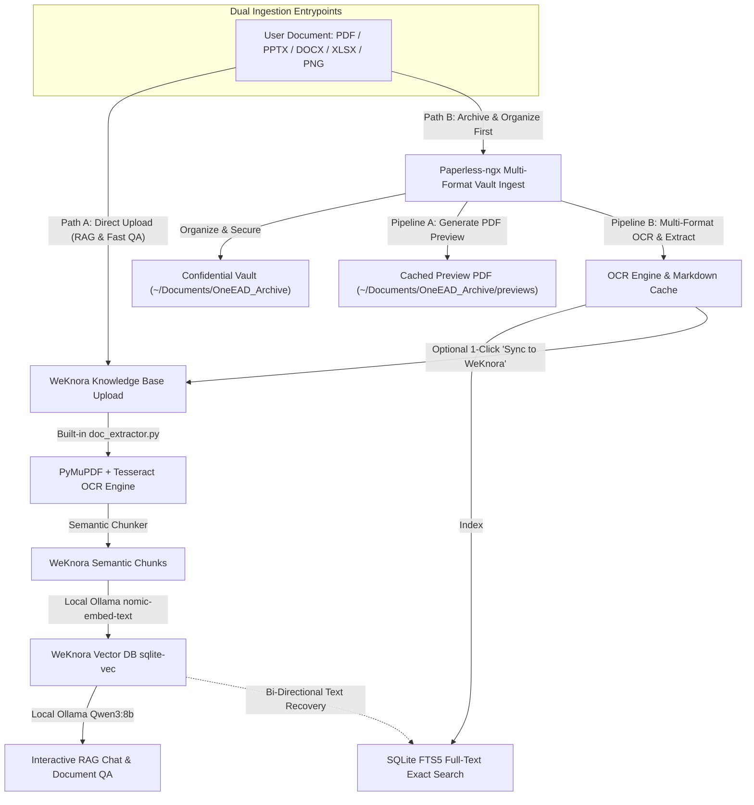

# Paperless-ngx (Lite Mode) — One EAD Plugin

**Paperless-ngx** for One EAD is a local-first, privacy-focused document vault, offline OCR pipeline, and document management platform. It organizes technical specifications, acoustics research papers, component datasheets, presentations, and design guidelines with zero cloud dependencies and 100% offline data privacy.

---

## 1. Core Architecture & Privacy by Design

### External Vault Isolation (`~/Documents/OneEAD_Archive`)
All confidential documents, PDFs, Office files, OCR texts, and SQLite databases are stored **strictly outside the Git workspace**:
* **Default Vault Path**: `C:\Users\<USER>\Documents\OneEAD_Archive`
* **Custom Override**: Configurable via the `ONEEAD_ARCHIVE_DIR` environment variable.

```
~/Documents/OneEAD_Archive/
├── documents/                  # Physical documents organized by category subfolders
│   ├── General Acoustic Knowledge/
│   ├── Component Datasheet/
│   ├── Acoustic Standard/
│   └── Design Guideline/
├── previews/                   # Converted high-fidelity preview PDFs for non-PDFs ({doc_id}.pdf)
├── meta.db                     # SQLite database (documents table & FTS5 virtual table)
├── ocr_cache/                  # Extracted full-text Markdown files ({doc_id}.md)
├── thumbnails/                 # First-page/slide PNG rendering cache
└── weknora_data/               # WeKnora Lite persistent database & vector storage
```

> [!IMPORTANT]
> **Data Privacy Guarantee**: Because files reside in `~/Documents/OneEAD_Archive`, user documents and confidential data can never be accidentally committed to git, inspected by automated git hooks, or ingested by version control tooling.

---

## 2. Multi-Format Dual-Pipeline Architecture

Paperless-ngx implements a **Dual-Pipeline Architecture** supporting **PDF, PowerPoint (.pptx/.ppt), Word (.docx/.doc), Excel (.xlsx/.xls), Images (PNG, JPG, JPEG, WEBP, BMP, TIFF), and Text (.txt, .md)**:

```
                        ┌─── [ PNG / JPG ] ──────► Tesseract OCR (Direct image text)
                        │
                        ├─── [ PDF ] ────────────► PyMuPDF ──► High-Res Raster ──► Tesseract OCR
Pipeline B:             │
(Clean Text & OCR)      ├─── [ DOCX / PPTX ] ────► python-docx / python-pptx ──► Direct Clean Text + OCR on images
                        │
                        └─── [ XLS / XLSX ] ─────► openpyxl / pandas ────────► Clean Tabular Markdown
─────────────────────────────────────────────────────────────────────────────────────────────────────────────
Pipeline A:             ├─── [ PDF ] ────────────► Native PDF Viewer
(Right-Panel Preview)   └─── [ PPTX/DOCX/XLSX/PNG]► High-Fidelity PDF Preview ──► Right Panel (< Page 1 of 44 >)
```

### Pipeline A: Right-Panel Inline Preview (Zero Browser Downloads)
- Web browsers (`<iframe>`) natively cannot render raw `.pptx`, `.docx`, or `.xlsx` files without triggering an automatic file download.
- When an Office document or image is uploaded or opened, Paperless-ngx converts and caches a high-fidelity PDF preview (`previews/{doc_id}.pdf`) using native Windows Office COM engines (`PowerPoint.Application`, `Word.Application`) with pure Python fallbacks (`python-pptx`, `docx`, `openpyxl` + PyMuPDF).
- The right panel renders the preview inline via `application/pdf`, allowing smooth slide-by-slide (`< Page 1 of 44 >`) and page-by-page flipping, zooming, and yellow search keyword highlights.
- **Original File Preservation**: Clicking the download button always delivers the original uncompressed file (`.pptx`, `.docx`, etc.).

### Pipeline B: Multi-Format Text & OCR Extraction
- **PNG / JPG / Images**: Directly processed by Tesseract OCR (100% offline, English and Simplified Chinese support).
- **PDF**: PyMuPDF vector text and table extraction with automatic Tesseract OCR fallback for scanned/raster pages.
- **DOCX / PPTX**: Clean structured digital text (headings, paragraphs, bullet points, tables, speaker notes) via `python-docx` / `python-pptx` combined with Tesseract OCR for embedded diagrams/photos.
- **XLS / XLSX**: Tabular Markdown extraction via `openpyxl` and `pandas`.
- All extracted text is indexed into SQLite `FTS5` (`unicode61` tokenizer) and synchronized to WeKnora for semantic RAG search.

---

## 3. Key Features & Implementation Details

### A. Instant Unified Toolbar & Full-Text Search (FTS5)
- **Dual Search Scopes**:
  - `Title + OCR` (Default): Searches both document filenames and extracted deep OCR/vector text in milliseconds using SQLite's native `fts5` virtual table with the `unicode61` tokenizer.
  - `Title Only`: Instant client-side filter by filename.
- **Debounced Execution**: Full-text queries debounce at 280ms to provide a lag-free search experience as you type.
- **Dynamic Category & Status Filtering**: Real-time filtering by category folders (e.g., *Component Datasheet*, *Acoustic Standard*) and OCR completion statuses (*OCR Ready*, *Digital*, *Pending*).

### B. Saved Views & Navigation
- **Documents**: Master list of all vault documents with active category breadcrumbs.
- **Recently Added**: Chronologically sorted view (newest ingested files first via `created_at` timestamp comparison).
- **Category Folders**: Instant filtered view with file counts.
- **Dashboard**: High-level telemetry displaying total files, disk vault size, and OCR engine status.

### C. 1-Click Windows File Explorer Integration
- Clicking **Explorer** on any document card or category opens the exact folder in Windows File Explorer.
- Uses Windows Win32 Shell APIs (`SHOpenFolderAndSelectItems`, `AttachThreadInput`, `BringWindowToTop`, `SetForegroundWindow`) to bring the matching Explorer window to the foreground and automatically highlight the exact file.

### D. Offline Tesseract OCR Engine (System & Embedded)
- **Auto-Detection**: Automatically detects local Tesseract OCR binaries (`tesseract.exe`) or activates PyMuPDF's embedded C++ Tesseract engine with local `tessdata` language packs (`eng`, `chi_sim`).
- **Smooth Large-Document Previews**: Document Markdown previews are delivered with a lightweight `?limit=40000` character preview and a "Load Complete Full Text" option, preventing browser freezes when previewing multi-megabyte technical manuals.
- **In-Memory Thumbnail Caching**: Thumbnails for PDFs, PPTX slides, Word pages, and images are served with `Cache-Control: public, max-age=86400, immutable`, preventing redundant disk reads.

---

## 4. Relationship with WeKnora Plugin

Paperless-ngx and [WeKnora](../weknora/README.md) work together as a complementary pair inside One EAD:

| Capability | Paperless-ngx | WeKnora (Lite Mode) |
| :--- | :--- | :--- |
| **Primary Role** | **Vault Storage, Multi-Format Organization & OCR** | **LLM Knowledge Retrieval (RAG) & Chat** |
| **Search Engine** | Exact keyword full-text search (SQLite `FTS5`) | Semantic vector similarity (`sqlite-vec`) + Hybrid |
| **Data Format** | Original files, PDF previews, thumbnails, and Markdown cache | Chunked vectors and relational knowledge graphs |
| **OS Integration** | 1-Click Windows File Explorer selection | Embedded Web UI reverse proxy |
| **AI Inference** | None (100% deterministic local Python/C) | Local LLM (`qwen3:8b`) & Embeddings (`nomic-embed-text`) |

### Cross-Plugin Data Flow & Dual Ingestion Pipeline



---

## 5. REST API Reference

The plugin backend is mounted at `/api/paperless-ngx` in One EAD:

| Endpoint | Method | Description |
| :--- | :--- | :--- |
| `/stats` | `GET` | Returns vault document counts, storage bytes, category breakdown, and Tesseract engine status. |
| `/tesseract` | `GET` | Returns local Tesseract OCR installation status, version, and language packs. |
| `/documents` | `GET` | Lists documents. Parameters: `q` (search query), `tag` (category), `status` (OCR state). |
| `/documents/{id}` | `GET` | Returns metadata for a single document. |
| `/documents/{id}/view` | `GET` | Streams the high-fidelity PDF preview inline for browser rendering without triggering downloads. |
| `/documents/{id}/download` | `GET` | Downloads the original file in its native format (.pptx, .docx, .xlsx, .pdf). |
| `/documents/{id}/thumbnail` | `GET` | Serves the cached first-page/slide PNG thumbnail (HTTP 86400s immutable cache). |
| `/documents/{id}/markdown` | `GET` | Returns extracted OCR Markdown. Optional `?limit=40000` for fast preview. |
| `/documents/{id}/ocr` | `POST` | Re-triggers local OCR and preview conversion for the document. |
| `/documents/{id}/tags` | `PUT` | Updates document tags/category. |
| `/documents/{id}` | `DELETE` | Deletes the document from SQLite, original disk file, preview PDF, thumbnail, and OCR cache. |
| `/documents/{id}/sync-weknora`| `POST` | Exports document Markdown into WeKnora's knowledge base. |
| `/upload` | `POST` | Uploads a new document (.pdf, .pptx, .docx, .xlsx, .png, .jpg) with category, tags, and auto-OCR. |
| `/open-explorer` | `POST` | Opens the vault or a specific document in Windows File Explorer. |

---

## 6. Development & Verification Rules

- **Zero Web Inspection of User Documents**: Never run scripts or browser tools that inspect, print, or expose files from `~/Documents/OneEAD_Archive`.
- **Synthetic Fixtures Only**: When testing, use temporary mock text files or synthetic documents created in scratch directories.
- **Frontend Verification**: UI testing is user-led in the browser. Do not run automated browser subagents or DOM extraction.
